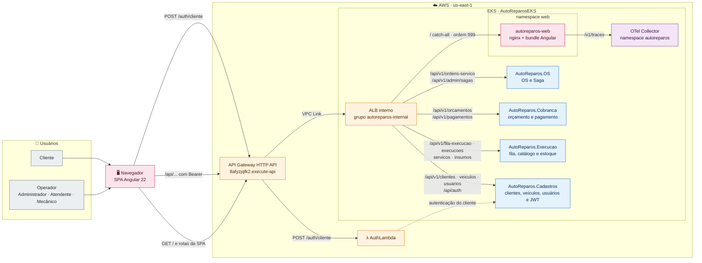
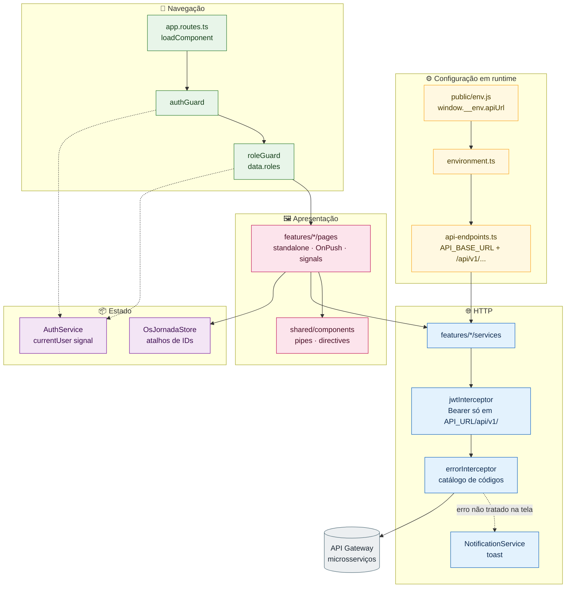
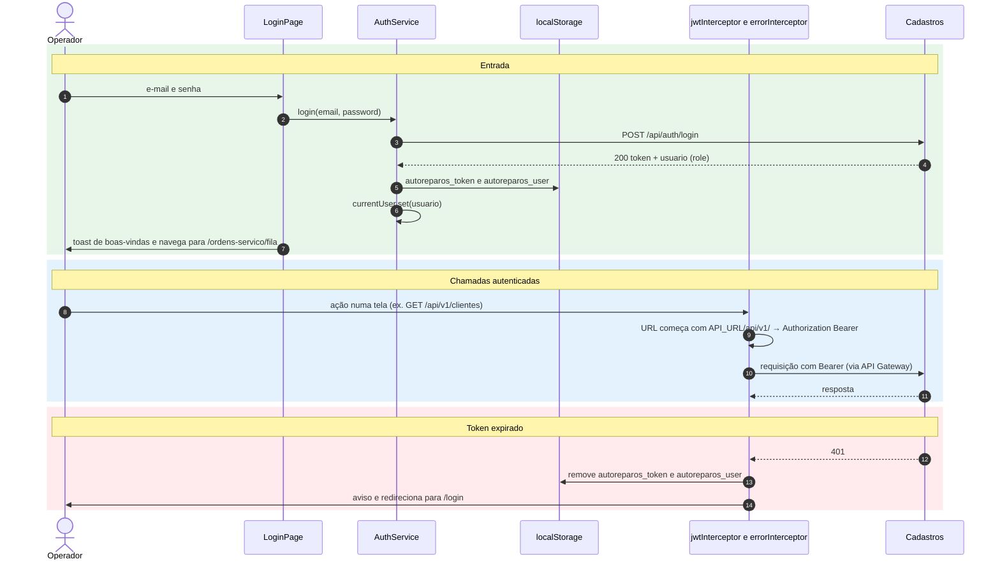
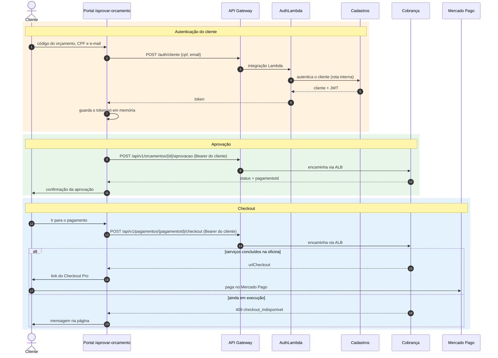
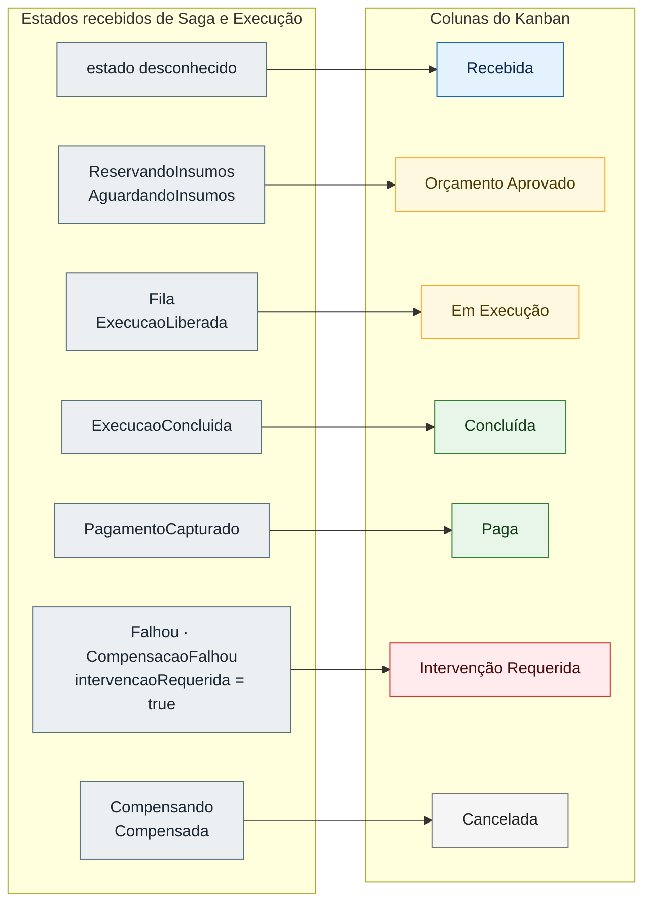
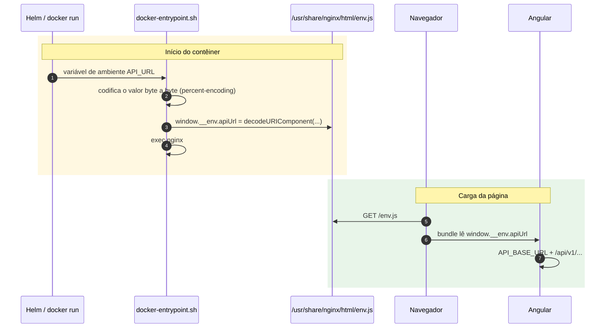
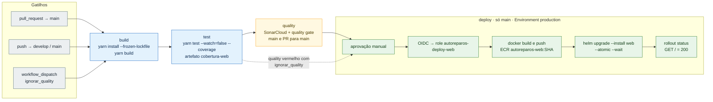

<div align="center">

# 🚗 AutoReparos.Web

**Frontend Angular do AutoReparos: a interface da oficina (operadores) e o portal de aprovação de orçamento (cliente) sobre os microsserviços da Fase 4.**

[](https://github.com/Grupo78-PosTech-15SOAT/AutoReparos.Web/actions/workflows/ci-cd.yml)
[](https://sonarcloud.io/project/overview?id=Grupo78-PosTech-15SOAT_AutoReparos.Web)


Tech Challenge FIAP · Pós-Tech SOAT · **Fase 4** (microsserviços, Saga e CI/CD) · Grupo 78

🌐 **Produção:** <https://8afyzjqfk2.execute-api.us-east-1.amazonaws.com>

</div>

---

## Sumário

1. [Visão geral](#1-visão-geral)
2. [Papel no ecossistema](#2-papel-no-ecossistema)
3. [Telas e perfis de acesso](#3-telas-e-perfis-de-acesso)
4. [Arquitetura do frontend](#4-arquitetura-do-frontend)
5. [Autenticação e sessão](#5-autenticação-e-sessão)
6. [Jornada da OS e quadro Kanban](#6-jornada-da-os-e-quadro-kanban)
7. [Integração com os microsserviços](#7-integração-com-os-microsserviços)
8. [Tratamento de erros](#8-tratamento-de-erros)
9. [Configuração (`API_URL` e demais variáveis)](#9-configuração-api_url-e-demais-variáveis)
10. [Como rodar localmente](#10-como-rodar-localmente)
11. [Testes e cobertura](#11-testes-e-cobertura)
12. [Build e Docker](#12-build-e-docker)
13. [CI/CD e deploy](#13-cicd-e-deploy)
14. [Observabilidade](#14-observabilidade)
15. [Limitações conhecidas](#15-limitações-conhecidas)
16. [Repositórios do projeto](#16-repositórios-do-projeto)

---

## 1. Visão geral

O `AutoReparos.Web` é a SPA (Single Page Application) do sistema de gestão de oficina mecânica AutoReparos. Ele foi extraído do antigo monólito (`AutoReparos.Cadastros`) para um repositório próprio (decisão **D-03**) e, na Fase 4, adaptado para falar **somente** com as rotas que os microsserviços já expõem (**D-69**), sem nenhuma alteração no backend.

| O que entrega | Para quem |
|---|---|
| Quadro Kanban das ordens de serviço, abertura, detalhe, observação e cancelamento de OS | Atendente e Administrador (consulta para todos os perfis) |
| Montagem de orçamento com itens do catálogo (serviços e insumos) | Atendente e Administrador |
| Fila de execução com etapas de diagnóstico e reparo, conclusão, falha e reexecução | Mecânico e Administrador |
| Checkout do Mercado Pago e reembolso | Operadores (reembolso só Administrador) |
| Console de Sagas: filtros, linha do tempo, comandos, registros e retentativa | Administrador |
| Cadastros de clientes, veículos, usuários, serviços e insumos | Conforme o perfil (ver [§ 3](#3-telas-e-perfis-de-acesso)) |
| Portal público de **aprovação de orçamento** e checkout | Cliente (CPF + e-mail) |

**Stack:** Angular 22 (standalone, signals, `OnPush`, controle de fluxo `@if`/`@for`), RxJS 7.8, TypeScript 6.0, Chart.js 4, OpenTelemetry Web, Vitest 4 + jsdom, nginx (`nginxinc/nginx-unprivileged`) e Helm.

> O projeto Angular mantém o nome interno `app-temp` (em `package.json` e `angular.json`); por isso o build sai em `dist/app-temp/browser`.

---

## 2. Papel no ecossistema

O navegador fala com **uma única origem**, a `API_URL`. Em produção ela fica vazia: o bundle usa URLs relativas e o **API Gateway** é, ao mesmo tempo, quem serve o Web (rota raiz) e quem encaminha `/api/...` aos microsserviços e `POST /auth/cliente` à AuthLambda. Assim não há URL por serviço no bundle nem CORS entre serviços.



Pontos importantes:

- **Rota raiz do gateway:** `ANY /` e `ANY /{proxy+}` vão ao ALB interno, onde o Ingress `autoreparos-web-ingress` assume o catch-all `/` com `group.order: 999`, depois dos Ingress de OS (10), Cobrança (20), Execução (30) e Cadastros (100). Os *deep links* do Angular (`/ordens-servico/...`) caem no `try_files ... /index.html` do nginx.
- **API:** `ANY /api/{proxy+}` vai ao mesmo ALB, que escolhe o serviço pelo prefixo.
- **Cliente:** `POST /auth/cliente` é a única rota que vai à AuthLambda; ela autentica o cliente no Cadastros e devolve o JWT usado na aprovação do orçamento.
- **Sem estado no servidor:** o Web não tem banco, fila nem segredo próprio. Sessão e atalhos ficam no `localStorage` do navegador (ver [§ 5](#5-autenticação-e-sessão)).

---

## 3. Telas e perfis de acesso

Os perfis vêm do campo `role` do usuário retornado no login (`Administrador`, `Atendente`, `Mecanico`). As rotas usam carregamento sob demanda (`loadComponent`) e dois guards funcionais: `authGuard` (exige token) e `roleGuard` (exige um dos perfis em `data.roles`).

| Rota | Tela | Acesso | O que faz |
|---|---|---|---|
| `/` | Início | 🌐 Público | Apresentação e atalhos; os cartões mudam conforme o perfil logado |
| `/login` | Login do operador | 🌐 Público | `POST /api/auth/login`; ao entrar, vai para o Kanban |
| `/aprovar-orcamento` | **Portal do cliente** | 🌐 Público (cliente informa CPF e e-mail) | Aprova o orçamento e abre o checkout; aceita `?orcamentoId=` na URL |
| `/ordens-servico` | → redireciona para `/ordens-servico/fila` | 🔐 Logado | — |
| `/ordens-servico/fila` | Kanban de OS | 🔐 Qualquer perfil | 7 colunas por status, cartões com placa, modelo e cliente e busca da OS pelo código |
| `/ordens-servico/nova` | Nova OS | 👤 Atendente · Administrador | Seleciona cliente e veículo do cliente e abre a OS |
| `/ordens-servico/:id` | Detalhe da OS | 🔐 Qualquer perfil | Histórico, cliente, veículo, execução, observação editável, links de orçamento/aprovação/pagamento e cancelamento (Atendente · Administrador) |
| `/ordens-servico/:id/orcamento` e `/orcamentos/novo` | Orçamento | 👤 Atendente · Administrador | Seletor de OS, itens de serviços e insumos do catálogo ou valor avulso |
| `/pagamentos` e `/pagamentos/:id` | Pagamento | 🔐 Qualquer perfil | Seletor de OS com pagamento conhecido, checkout Mercado Pago e reembolso (só Administrador) |
| `/fila-execucao` | Fila de execução | 🔧 Mecânico · Administrador | Filtros por estado e mecânico; etapas, conclusão e falha; reexecução só Administrador |
| `/sagas` | Console de Sagas | 🛡️ Administrador | Tabela filtrável por estado e tempo parado; drawer com abas Etapas, Comandos e Registros; retentativa com motivo |
| `/clientes` | Clientes | 🔐 Qualquer perfil | CRUD paginado com máscara de CPF/CNPJ |
| `/veiculos` | Veículos | 🔐 Qualquer perfil | CRUD paginado (placa, chassi, renavam) vinculado a cliente |
| `/servicos` | Catálogo de serviços | 👤 Administrador · Atendente · Mecânico | Lista; cadastro só Administrador |
| `/insumos` | Estoque de insumos | 👤 Administrador · Atendente · Mecânico | Lista com disponível/reservado; cadastro só Administrador; entrada de estoque Administrador · Atendente |
| `/usuarios` | Usuários | 🛡️ Administrador | CRUD paginado com perfil (`tipo` numérico 1, 2 ou 3) |
| `**` | → redireciona para `/` | — | — |

> Sem perfil adequado, o `roleGuard` mostra o aviso "Acesso Negado" e volta ao Kanban. Sem token, o `authGuard` manda para `/login` com `returnUrl`. A barra de navegação esconde os itens que o perfil não acessa.

---

## 4. Arquitetura do frontend

### 4.1 Estrutura de pastas

```text
AutoReparos.Web/
├── src/
│   ├── main.ts                      # inicia o tracing OpenTelemetry e faz o bootstrap da aplicação
│   ├── index.html                   # carrega env.js antes do bundle
│   ├── styles.css                   # tokens CSS (cores, espaçamentos) e classes globais
│   ├── test-setup.ts                # Storage em memória para os testes (Node 25+)
│   ├── environments/environment.ts  # apiUrl = window.__env.apiUrl
│   └── app/
│       ├── app.config.ts            # router, HttpClient + interceptors, ErrorHandler, locale pt-BR e BRL
│       ├── app.routes.ts            # rotas lazy com authGuard e roleGuard
│       ├── core/
│       │   ├── auth/                # authGuard, roleGuard
│       │   ├── config/              # api-endpoints.ts (todos os paths HTTP)
│       │   ├── error/               # GlobalErrorHandler
│       │   ├── http/                # jwtInterceptor, errorInterceptor, error-catalog, http-context
│       │   ├── store/               # OsJornadaStore (signals + localStorage)
│       │   ├── telemetry/           # initFrontendTracing
│       │   ├── tokens/              # STORAGE_TOKEN (localStorage injetável)
│       │   └── ui/                  # NotificationService, LoadingService
│       ├── features/                # uma pasta por domínio: models/, services/, pages/
│       │   ├── auth/  clientes/  veiculos/  usuarios/
│       │   ├── ordens-servico/  orcamento/  pagamento/
│       │   ├── execucao/  servicos/  insumos/  sagas/
│       │   ├── portal-publico/      # aprovação de orçamento pelo cliente
│       │   └── home/
│       └── shared/
│           ├── components/          # navbar, toast, modal-dialog, drawer, alert-banner, custom-select,
│           │                        # id-badge, placa-badge, documento-badge, status-badge, data-hora,
│           │                        # pagination, page-container, progress-bar, loading-spinner
│           ├── directives/          # appMask (CPF/CNPJ, placa)
│           ├── pipes/               # moeda, cpfCnpj, placa, statusOS
│           └── utils/               # status-os.utils, data-hora.utils
├── public/env.js                    # window.__env.apiUrl (sobrescrito no contêiner)
├── nginx.conf · docker-entrypoint.sh · Dockerfile · docker-compose.yml
├── deploy/helm/web/                 # chart do release web (Deployment, Service, Ingress)
└── .github/workflows/ci-cd.yml      # build → test → quality → deploy
```

### 4.2 Padrões adotados

| Padrão | Onde aparece |
|---|---|
| **Componentes standalone** com `ChangeDetectionStrategy.OnPush` | Todas as páginas e componentes; não há `NgModule` |
| **Signals** para estado de tela e sessão | `signal`, `computed` e `asReadonly()` em páginas, `AuthService.currentUser` e `OsJornadaStore` |
| **`inject()`** em vez de construtor | Serviços, guards e interceptors |
| **Rotas lazy** | `loadComponent` em todas as rotas de `app.routes.ts`; `withComponentInputBinding()` liga parâmetros de rota a inputs |
| **Interceptors funcionais** | `provideHttpClient(withInterceptors([jwtInterceptor, errorInterceptor]))` |
| **Guards funcionais** | `authGuard` e `roleGuard` (`CanActivateFn`) |
| **Erro tratado na tela** | `HttpContextToken` `STATUS_TRATADOS_NA_TELA`: a chamada declara quais status a própria tela trata e o interceptor não mostra toast para eles |
| **Limpeza de assinaturas** | `takeUntilDestroyed(DestroyRef)` |
| **Endpoints centralizados** | Os paths HTTP ficam todos em `core/config/api-endpoints.ts`, montados sobre `API_BASE_URL` |
| **Storage injetável** | `STORAGE_TOKEN` (padrão `localStorage`), substituído nos testes |
| **Localização** | `LOCALE_ID = 'pt-BR'`, `DEFAULT_CURRENCY_CODE = 'BRL'`; pipe `moeda`, datas com tempo relativo |
| **Sistema visual comum** | Tokens CSS em `styles.css` e componentes compartilhados (`ModalDialog`, `AlertBanner`, `PageContainer`, `Drawer`, badges, `custom-select` com busca anexado ao `body`) |

### 4.3 Camadas e fluxo de uma requisição



---

## 5. Autenticação e sessão

Há dois tipos de identidade, com tokens e armazenamento diferentes:

| | Operador | Cliente |
|---|---|---|
| Endpoint | `POST /api/auth/login` (Cadastros) | `POST /auth/cliente` (AuthLambda) |
| Credenciais | e-mail e senha | CPF e e-mail |
| Onde o token fica | `localStorage`: `autoreparos_token` e `autoreparos_user` | Só em memória (signal da página), descartado ao sair dela |
| Como vai às APIs | `jwtInterceptor` acrescenta `Authorization: Bearer` apenas às URLs que começam com `API_URL/api/v1/` | A página do portal envia o header explicitamente; o interceptor não sobrescreve um `Authorization` existente |
| Expiração | `401` fora do login limpa a sessão e volta a `/login` | `401`/`403` viram mensagem na própria página |

### 5.1 Login do operador



O logout (`AuthService.logout`) remove o token, o usuário **e** os atalhos do `OsJornadaStore`.

### 5.2 Aprovação de orçamento pelo cliente

O operador compartilha o link do Detalhe da OS, que leva **só** o `orcamentoId` (`/aprovar-orcamento?orcamentoId=...`). O cliente digita o próprio CPF e e-mail; nenhum dado pessoal vai para a URL nem para o `localStorage` (**D-71**).



Erros `401`, `403`, `404`, `409` e `422` dessas chamadas são tratados na própria página, com a mensagem do catálogo de códigos.

---

## 6. Jornada da OS e quadro Kanban

### 6.1 Jornada ponta a ponta na interface

```mermaid
flowchart LR
    subgraph AT["👤 Atendente / Administrador"]
        A1["Nova OS<br/>POST ordens-servico"]
        A2["Detalhe da OS"]
        A3["Orçamento<br/>POST orcamentos"]
        A4["Link de aprovação<br/>?orcamentoId="]
    end

    subgraph CLI["🙋 Cliente"]
        C1["Portal<br/>POST /auth/cliente"]
        C2["Aprovar<br/>POST orcamentos/{id}/aprovacao"]
    end

    subgraph BK["⚙️ Backend · Saga no OS"]
        S1["reserva de insumos<br/>e liberação da execução"]
    end

    subgraph MEC["🔧 Mecânico / Administrador"]
        M1["Fila de execução"]
        M2["Etapas<br/>Diagnóstico · Reparo"]
        M3["Conclusão"]
    end

    subgraph PAG["💳 Pagamento"]
        P1["Checkout<br/>POST pagamentos/{id}/checkout"]
        P2["Mercado Pago<br/>Checkout Pro"]
    end

    A1 --> A2 --> A3 --> A4 --> C1 --> C2 --> S1 --> M1 --> M2 --> M3 --> P1 --> P2

    classDef at fill:#FCE4EC,stroke:#C2185B,color:#4A0E25
    classDef cli fill:#FFF3E0,stroke:#EF6C00,color:#4E2600
    classDef bk fill:#ECEFF1,stroke:#546E7A,color:#1C2833
    classDef mec fill:#E3F2FD,stroke:#1565C0,color:#0D2A4F
    classDef pag fill:#E8F5E9,stroke:#2E7D32,color:#123D17
    class A1,A2,A3,A4 at
    class C1,C2 cli
    class S1 bk
    class M1,M2,M3 mec
    class P1,P2 pag
```



O Web não orquestra nada: ele só chama as rotas acima e **mostra** o estado que a Saga do serviço OS e a Execução publicam. Cancelamento (`POST /api/v1/ordens-servico/{id}/cancelamento`) e retentativa da Saga (`POST /api/v1/admin/sagas/{id}/retentar`) também são pedidos ao backend, com motivo obrigatório.

### 6.2 De onde vêm os cartões

O backend **não tem listagem de OS**. O Kanban (`OsKanbanPageComponent`) monta o quadro juntando três fontes, sem duplicar cartões:

1. `GET /api/v1/admin/sagas`: todas as Sagas (só para o Administrador).
2. `GET /api/v1/fila-execucao`: OS com execução. Para o Atendente a resposta é `403`, que vira o estado "sem acesso à execução", sem erro (**D-71**).
3. **Atalhos locais** do `OsJornadaStore` (OS abertas ou vistas neste navegador), consultados por `GET /api/v1/ordens-servico/{id}`, mais a busca por código.

Cada cartão mostra placa, modelo e cliente, resolvidos uma única vez por `GET /api/v1/veiculos/{id}` e `GET /api/v1/clientes/{id}` (cache em memória no `OsConhecidasService`).

### 6.3 Status da OS e colunas

`shared/utils/status-os.utils.ts` é a **única** tabela de status no Web e espelha os 7 status reais da OS. Estados da Saga e da Execução que não são status da OS são mapeados para a coluna correspondente:



Um status que já é um dos 7 da OS vai direto para a sua coluna.

### 6.4 `OsJornadaStore`

Atalho local **opcional** que guarda só IDs (`osId`, `clienteId`, `veiculoId`, `orcamentoId`, `pagamentoId`) na chave `autoreparos_os_jornada_v1` do `localStorage`, com no máximo 100 registros, e é limpo no logout. Ele liga OS → orçamento → pagamento entre telas e alimenta os seletores de OS do Orçamento e do Pagamento (busca por código, placa, modelo e cliente). Para o Administrador, `GET /api/v1/admin/sagas/{osId}` é a fonte no servidor do `orcamentoId`; o `pagamentoId` pode ser digitado quando não está no atalho.

---

## 7. Integração com os microsserviços

Todas as URLs são `API_URL` + path. Os paths HTTP estão em [`src/app/core/config/api-endpoints.ts`](src/app/core/config/api-endpoints.ts); a coluna "Tela" indica quem chama.

<details open>
<summary><b>🧾 AutoReparos.OS</b> — ordens de serviço e Saga</summary>

| Método | Endpoint | Tela |
|---|---|---|
| `POST` | `/api/v1/ordens-servico` | Nova OS (`422` tratado no formulário) |
| `GET` | `/api/v1/ordens-servico/{id}` | Detalhe, busca no Kanban, atalhos e seletores de OS |
| `PATCH` | `/api/v1/ordens-servico/{id}` | Detalhe (observação) |
| `POST` | `/api/v1/ordens-servico/{id}/cancelamento` | Detalhe (`{ motivo }`; Atendente · Administrador) |
| `GET` | `/api/v1/admin/sagas?estado=&paradaHaMinutos=` | Console de Sagas e Kanban |
| `GET` | `/api/v1/admin/sagas/{ordemServicoId}` | Drawer da Saga; `orcamentoId` no Detalhe |
| `POST` | `/api/v1/admin/sagas/{ordemServicoId}/retentar` | Console de Sagas (`{ motivo }`) |

</details>

<details open>
<summary><b>💰 AutoReparos.Cobranca</b> — orçamento, pagamento e reembolso</summary>

| Método | Endpoint | Tela |
|---|---|---|
| `POST` | `/api/v1/orcamentos` | Orçamento: `valor: 0` com `itens` agrupados, ou `valor` avulso sem itens |
| `POST` | `/api/v1/orcamentos/{id}/aprovacao` | Portal do cliente (JWT do cliente) |
| `POST` | `/api/v1/pagamentos/{id}/checkout` | Pagamento (operador) e Portal (cliente); devolve a URL do Checkout Pro |
| `POST` | `/api/v1/pagamentos/{id}/reembolsos` | Pagamento (`{ valor, motivo, referencia }`; só Administrador) |

</details>

<details open>
<summary><b>🔧 AutoReparos.Execucao</b> — fila, etapas, catálogo e estoque</summary>

| Método | Endpoint | Tela |
|---|---|---|
| `GET` | `/api/v1/fila-execucao?status=&mecanico=` | Fila de execução, Kanban e Detalhe |
| `POST` | `/api/v1/execucoes/{id}/etapas` | Fila (`{ tipo: Diagnostico \| Reparo, descricao }`) |
| `POST` | `/api/v1/execucoes/{id}/conclusao` | Fila (só em `EmExecucao`) |
| `POST` | `/api/v1/execucoes/{id}/falha` | Fila (`{ motivo }`, em `Fila` ou `EmExecucao`) |
| `POST` | `/api/v1/execucoes/{id}/reexecucao` | Fila (`{ motivo }`, só em `Falhou`; Administrador) |
| `GET` `POST` | `/api/v1/servicos` | Catálogo de serviços e itens do Orçamento |
| `GET` `POST` | `/api/v1/insumos` | Estoque e itens do Orçamento |
| `POST` | `/api/v1/insumos/{id}/entradas` | Entrada de estoque |

</details>

<details open>
<summary><b>🗂️ AutoReparos.Cadastros</b> e <b>λ AutoReparos.AuthLambda</b> — identidade e cadastros</summary>

| Método | Endpoint | Tela |
|---|---|---|
| `POST` | `/api/auth/login` | Login do operador (sem Bearer) |
| `POST` | `/auth/cliente` | Portal do cliente (AuthLambda, sem Bearer) |
| `GET` `POST` | `/api/v1/clientes?pageNumber=&pageSize=` | Clientes e Nova OS |
| `GET` `PUT` `DELETE` | `/api/v1/clientes/{id}` | Clientes; nome do cliente no Kanban e no Detalhe |
| `GET` `POST` | `/api/v1/veiculos?pageNumber=&pageSize=` · `?clienteId=&pageSize=100` | Veículos e Nova OS (veículos do cliente) |
| `GET` `PUT` `DELETE` | `/api/v1/veiculos/{id}` | Veículos; placa e modelo no Kanban, na Fila e no Detalhe |
| `GET` `POST` | `/api/v1/usuarios?pageNumber=&pageSize=` | Usuários |
| `PUT` `DELETE` | `/api/v1/usuarios/{id}` | Usuários (`{ nomeCompleto, tipo }`, `tipo` 1 Administrador, 2 Atendente, 3 Mecânico) |

</details>

---

## 8. Tratamento de erros

O `errorInterceptor` lê o `codigo` do corpo de erro e o traduz por `core/http/error-catalog.ts`, que reúne os códigos de domínio de OS, Cobrança, Execução e Cadastros (por exemplo `saga_em_andamento`, `orcamento_nao_pendente`, `checkout_indisponivel`, `execucao_estado_invalido`, `veiculo_de_outro_cliente`, `cadastros_indisponivel`) e mensagens padrão por status (`400`, `401`, `403`, `404`, `409`, `422`, `503`).

| Situação | Comportamento |
|---|---|
| Status declarado em `STATUS_TRATADOS_NA_TELA` | Sem toast; a tela mostra a mensagem no próprio formulário ou num `AlertBanner` |
| `401` no login | Toast "Falha no Login" |
| `401` em outra chamada | Aviso, limpeza da sessão e volta para `/login` |
| `400` | Toast "Erro de Validação" com o detalhe da resposta |
| `404` e `409` com mensagem conhecida | Toast de aviso |
| Demais status conhecidos | Toast de erro com a mensagem do catálogo |
| `0` ou `5xx` sem mensagem | "Não foi possível se comunicar com o backend" |
| Exceção não capturada | `GlobalErrorHandler` registra no console e mostra "Falha de Sistema" |

---

## 9. Configuração (`API_URL` e demais variáveis)

### 9.1 Como a `API_URL` chega ao navegador

O bundle **não** é recompilado por ambiente. O `index.html` carrega `env.js` antes da aplicação; `environment.ts` lê `window.__env.apiUrl` e `api-endpoints.ts` monta todos os paths sobre esse valor.



| `API_URL` no contêiner | Resultado |
|---|---|
| Não definida | Mantém o `public/env.js` versionado (`http://localhost:8080`) |
| Definida como string vazia (`""`) | URLs **relativas** à origem da página; é o valor de produção (`config.apiUrl: ""` no chart) |
| Definida com uma URL (ex. `http://localhost:8080`) | Todas as chamadas vão para essa origem |

O valor é codificado antes de ir para o `env.js`, então aspas ou barras na variável não quebram o JavaScript gerado.

### 9.2 Variáveis do contêiner

| Variável | Padrão | Uso |
|---|---|---|
| `API_URL` | *(não definida)* | Base das chamadas do navegador (ver acima). **Vazia em produção** |
| `OTEL_COLLECTOR_HOST` | `autoreparos-otel-collector` | Host do OpenTelemetry Collector para onde o nginx encaminha `/v1/traces` (porta 4318). Em produção: `autoreparos-otel-collector.autoreparos.svc.cluster.local` |
| `OS_URL` | `http://autoreparos-os:8080` | Destino do proxy local de `/api/v1/ordens-servico` e `/api/v1/admin/sagas` |
| `COBRANCA_URL` | `http://autoreparos-cobranca:8080` | Destino de `/api/v1/orcamentos` e `/api/v1/pagamentos` |
| `EXECUCAO_URL` | `http://autoreparos-execucao:8080` | Destino de `/api/v1/execucoes`, `/api/v1/fila-execucao`, `/api/v1/servicos` e `/api/v1/insumos` |
| `CADASTROS_URL` | `http://autoreparos-cadastros:8080` | Destino de `/api/v1/clientes`, `/api/v1/veiculos`, `/api/v1/usuarios` e `/api/auth` |

O `docker-entrypoint.sh` grava esses valores no `nginx.conf` e troca o `resolver` pelo DNS do ambiente (`/etc/resolv.conf`), então o mesmo contêiner funciona no Docker e no Kubernetes. O proxy resolve os nomes **na hora da requisição**: o contêiner sobe mesmo sem os serviços ou o collector na rede.

### 9.3 Rotas do nginx

| Location | Destino |
|---|---|
| `= /health` | `200 healthy` (probes do Kubernetes) |
| `/v1/traces` | OpenTelemetry Collector (`OTEL_COLLECTOR_HOST:4318`) |
| `/api/v1/ordens-servico`, `/api/v1/admin/sagas` | `OS_URL` |
| `/api/v1/orcamentos`, `/api/v1/pagamentos` | `COBRANCA_URL` |
| `/api/v1/execucoes`, `/api/v1/fila-execucao`, `/api/v1/servicos`, `/api/v1/insumos` | `EXECUCAO_URL` |
| `/api/v1/clientes`, `/api/v1/veiculos`, `/api/v1/usuarios`, `/api/auth` | `CADASTROS_URL` |
| outros `/api/v1/` | `404` |
| `/` | arquivos estáticos com `try_files $uri $uri/ /index.html` (deep links do Angular) |

> Em produção, o API Gateway e o ALB já encaminham `/api/...` aos serviços antes de chegar ao Web; o proxy do nginx serve para rodar a imagem com `API_URL` vazia fora da nuvem.

### 9.4 Chaves no `localStorage`

| Chave | Conteúdo |
|---|---|
| `autoreparos_token` | JWT do operador |
| `autoreparos_user` | Nome, e-mail e perfil do operador |
| `autoreparos_os_jornada_v1` | Atalhos de IDs da jornada da OS (até 100) |

Nenhum segredo é versionado neste repositório. O Web não tem segredo de runtime; o único segredo do pipeline é o `SONAR_TOKEN` do GitHub.

---

## 10. Como rodar localmente

**Requisitos:** Node.js 22 (versão do CI e da imagem) e Yarn 1.22.22 (`packageManager` do `package.json`, via Corepack). Use o `yarn.lock` versionado.

```bash
corepack enable
yarn install --frozen-lockfile
yarn dev          # ng serve --watch em http://localhost:4200
```

| Script | Comando | Para quê |
|---|---|---|
| `yarn dev` | `ng serve --watch` | Servidor de desenvolvimento com recarga |
| `yarn start` | `ng serve` | Servidor de desenvolvimento |
| `yarn build` | `ng build` | Build de produção (configuração padrão) em `dist/app-temp/browser` |
| `yarn watch` | `ng build --watch --configuration development` | Build de desenvolvimento contínuo |
| `yarn test` | `ng test` | Testes unitários com Vitest |

**Para onde a API aponta:** em `yarn dev` o navegador usa o `public/env.js` versionado (`http://localhost:8080`). Para apontar para outro backend sem recompilar, altere esse arquivo localmente (sem commitar) ou rode a imagem Docker com `API_URL` (ver [§ 12](#12-build-e-docker)).

> O portal do cliente depende de `POST /auth/cliente`, que só existe no API Gateway (AuthLambda); o proxy do nginx não encaminha essa rota.

---

## 11. Testes e cobertura

Os testes usam o builder `@angular/build:unit-test` com **Vitest** e **jsdom**. O `src/test-setup.ts` garante um `localStorage`/`sessionStorage` funcional em memória quando o global do Node não serve (Node 25+). Cada serviço, página e componente relevante tem um `*.spec.ts` ao lado, com `HttpTestingController` para as chamadas HTTP e `STORAGE_TOKEN` substituído.

```bash
yarn test --watch=false              # roda todos os testes uma vez
yarn test --watch=false --coverage   # gera coverage/app-temp (html, lcov e resumo)
```

### Cobertura

Execução local em 17/11/2026, na `main` (`3d1c92d`):

| Métrica | Resultado |
|---|---|
| Arquivos de teste | 35 |
| Testes | **486 aprovados** |
| Linhas | **95,53%** |
| Statements | 92,32% |

A meta do grupo é **80%** de cobertura no código novo (**D-69**). O `lcov` (`coverage/app-temp/lcov.info`) é publicado como artefato do CI e analisado no [SonarCloud](https://sonarcloud.io/project/overview?id=Grupo78-PosTech-15SOAT_AutoReparos.Web), cujo quality gate o pipeline aguarda (`sonar.qualitygate.wait=true`).

---

## 12. Build e Docker

A imagem é *multi-stage*:

1. **build** (`node:22-alpine`): `yarn install --frozen-lockfile --ignore-scripts` e `yarn build --configuration production`.
2. **runtime** (`nginxinc/nginx-unprivileged:alpine`): copia `dist/app-temp/browser`, o `nginx.conf` e o `docker-entrypoint.sh`; roda como usuário `nginx`, sem root, na porta **8080**.

O build de produção aplica *output hashing* e os orçamentos de tamanho do `angular.json` (inicial: aviso em 500 kB, erro em 1 MB).

```bash
docker build -t autoreparos-web .

# API em outra origem
docker run --rm -p 8081:8080 -e API_URL=http://localhost:8080 autoreparos-web

# Mesma origem: o nginx da imagem encaminha /api/... aos serviços
docker run --rm -p 8081:8080 -e API_URL= \
  -e OS_URL=http://<host-do-os>:<porta> \
  -e COBRANCA_URL=http://<host-da-cobranca>:<porta> \
  -e EXECUCAO_URL=http://<host-da-execucao>:<porta> \
  -e CADASTROS_URL=http://<host-do-cadastros>:<porta> \
  autoreparos-web
```

A interface fica em `http://localhost:8081`. No segundo exemplo, troque os marcadores pelos endereços onde os serviços estiverem rodando, acessíveis de dentro do contêiner.

O `docker-compose.yml` sobe o serviço `frontend` (contêiner `autoreparos-frontend`) em `http://localhost:4200` com `API_URL=http://localhost:8080`:

```bash
docker compose up --build
```

---

## 13. CI/CD e deploy

### 13.1 Pipeline (`.github/workflows/ci-cd.yml`)



| Job | Quando roda | O que faz |
|---|---|---|
| `build` | Sempre | Node 22 com cache do Yarn, `yarn install --frozen-lockfile`, `yarn build` |
| `test` | Depois do `build` | `yarn test --watch=false --coverage` e publica `coverage/` como artefato `cobertura-web` |
| `quality` | Push ou disparo na `main` e PR para a `main` | Exige o segredo `SONAR_TOKEN`, baixa a cobertura e roda o SonarCloud aguardando o quality gate |
| `deploy` | Só na `main`, com `build` e `test` verdes e `quality` verde (ou disparo manual com `ignorar_quality`); nunca em run cancelado | Imagem → ECR → Helm → verificação |

Detalhes do pipeline:

- **Ações fixadas por SHA** e `permissions: contents: read` por padrão; só o `deploy` pede `id-token: write` para o OIDC.
- **Concorrência:** fora da `main`, um push novo cancela o run anterior; na `main` não, para não deixar a release Helm presa em `pending-upgrade`. O `deploy` tem grupo próprio (`deploy-web-production`) sem cancelamento.
- **Escape `ignorar_quality`:** disparo manual na `main` que aceita o `quality` vermelho, mas nunca `build` ou `test` vermelhos (mesmo mecanismo do Cadastros).
- **Verificação pós-deploy:** `kubectl rollout status` e `port-forward` para o Service, exigindo `GET /` com `200`.
- **Variáveis do Environment `production`:** `AWS_ROLE_ARN`, `EKS_CLUSTER_NAME` e `AWS_REGION` (padrão `us-east-1`).

### 13.2 Fluxo de branches

A branch de integração é a `develop`; as mudanças chegam à `main` por pull request, que roda `build`, `test` e `quality`. O deploy em produção acontece só a partir da `main` e espera a aprovação de um revisor no Environment `production`, que também restringe o deploy à `main` (**D-74**).

### 13.3 Produção

| Item | Valor |
|---|---|
| URL pública | <https://8afyzjqfk2.execute-api.us-east-1.amazonaws.com> (raiz do API Gateway) |
| Cluster | EKS `AutoReparosEKS`, região `us-east-1` |
| Namespace / release Helm | `web` / `web` (deploy próprio, **D-72**) |
| Imagem | ECR `autoreparos-web`, tag = SHA do commit |
| Objetos | Deployment e Service `autoreparos-web` (ClusterIP `80 → 8080`), Ingress `autoreparos-web-ingress` |
| Ingress | `alb`, grupo `autoreparos-internal`, esquema `internal`, `target-type: ip`, `group.order: 999` (catch-all `/`) |
| Réplicas e recursos | 1 réplica; requests `50m` CPU / `64Mi`, limits `250m` / `128Mi` |
| Probes | readiness e liveness em `GET /health` |
| Configuração | `API_URL=""` e `OTEL_COLLECTOR_HOST=autoreparos-otel-collector.autoreparos.svc.cluster.local` |

O chart fica em [`deploy/helm/web`](deploy/helm/web) ([`values.yaml`](deploy/helm/web/values.yaml)). Para validar localmente:

```bash
helm template web deploy/helm/web --namespace web
```

---

## 14. Observabilidade

`src/app/core/telemetry/telemetry.init.ts` inicia o OpenTelemetry Web antes do bootstrap:

- `service.name = autoreparos-web`;
- instrumentação de `fetch` e `XMLHttpRequest` com propagação **W3C Trace Context** e **Baggage** (header `traceparent`) para as chamadas da aplicação, ligando o trace do navegador aos traces dos microsserviços;
- exportação OTLP/HTTP para `/v1/traces` na própria origem, que o nginx encaminha ao collector definido por `OTEL_COLLECTOR_HOST`.

---

## 15. Limitações conhecidas

- **Sem listagem de OS no backend:** o Kanban e os seletores de OS só mostram as OS que chegam pelas Sagas (Administrador), pela fila de execução ou pelos atalhos locais deste navegador; a busca por código encontra qualquer OS.
- **Atalhos por navegador:** o `OsJornadaStore` vive no `localStorage`; outro navegador não vê os mesmos atalhos. O `pagamentoId` pode ser digitado na tela de Pagamento.
- **Cliente só com CPF:** a AuthLambda aceita CPF de 11 dígitos; cliente PJ (CNPJ) não consegue entrar no portal.
- **Fora do escopo do Web:** reprocessamento de DLQ e qualquer mudança de rota, DTO ou migration nos serviços (**D-69**, **D-70**).

---

## 16. Repositórios do projeto

| Repositório | Papel |
|---|---|
| [AutoReparos](https://github.com/Grupo78-PosTech-15SOAT/AutoReparos) | Repositório pai: submódulos, especificações e decisões da Fase 4 |
| [AutoReparos.OS](https://github.com/Grupo78-PosTech-15SOAT/AutoReparos.OS) | Ordens de serviço e orquestrador da Saga |
| [AutoReparos.Cobranca](https://github.com/Grupo78-PosTech-15SOAT/AutoReparos.Cobranca) | Orçamento, aprovação, pagamento (Mercado Pago) e reembolso |
| [AutoReparos.Execucao](https://github.com/Grupo78-PosTech-15SOAT/AutoReparos.Execucao) | Fila de execução, etapas, catálogo de serviços e insumos |
| [AutoReparos.Cadastros](https://github.com/Grupo78-PosTech-15SOAT/AutoReparos.Cadastros) | Clientes, veículos, usuários e emissão de JWT |
| [AutoReparos.AuthLambda](https://github.com/Grupo78-PosTech-15SOAT/AutoReparos.AuthLambda) | Autenticação do cliente por CPF (`POST /auth/cliente`) |
| [AutoReparos.Infra.K8s](https://github.com/Grupo78-PosTech-15SOAT/AutoReparos.Infra.K8s) | Plataforma: rede, EKS, API Gateway e observabilidade |
| [AutoReparos.Infra.Database](https://github.com/Grupo78-PosTech-15SOAT/AutoReparos.Infra.Database) | Banco de dados gerenciado (RDS) |
| **AutoReparos.Web** | Este repositório: frontend Angular |

<div align="center">

---

Grupo 78 · FIAP Pós-Tech Software Architecture (SOAT) · Fase 4

</div>
